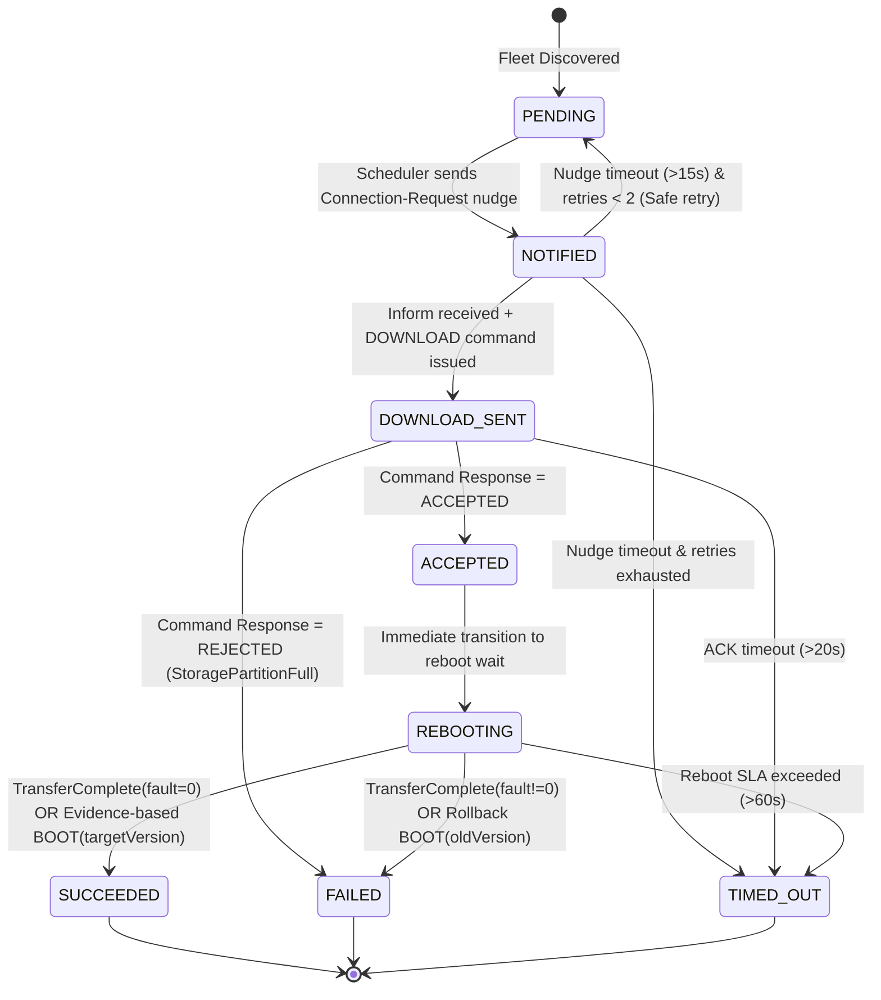

# Broadband Device Management: Firmware Upgrade Campaign Controller

A production-grade, fault-tolerant firmware upgrade campaign management service designed for large-scale CPE gateway fleets (e.g., AT&T BGW320/BGW210). Built on **Java 21 Virtual Threads**, **Spring Boot 3.3.4**, **OAuth2 / JWT Bearer Authentication**, **Redis/DB Distributed Idempotency**, and **Resilience4j Circuit Breaking**.

---

## Architecture & Security Model

```
                    +-------------------------------------------------------+
                    |           Spring Boot Application (Port 8000)         |
                    |                                                       |
  Operator / Client |  +-----------------------+   +----------------------+  |
  ----------------->|  | Authorization Server  |   |   Resource Server    |  |
   (demo-client)    |  |  POST /oauth2/token   |   |   JWT Bearer Auth    |  |
                    |  +-----------+-----------+   +----------+-----------+  |
                    |              |                          |             |
                    |              v                          v             |
                    |       [RSA Key Pair]       +------------------------+ |
                    |      (jwt_private.pem      |  Idempotency Engine    | |
                    |      / jwt_public.pem)     |  (Header + Redis/DB)   | |
                    |                            +-----------+------------+ |
                    |                                        |              |
                    |                                        v              |
                    |                            +------------------------+ |
                    |                            |   Campaign Engine &    | |
                    |                            | Circuit Breaker Guard  | |
                    |                            +-----------+------------+ |
                    +----------------------------------------|--------------+
                                                             | (REST Nudge)
                                                             v
                                           +----------------------------------+
                                           |  Fleet Simulator (Port 8001)     |
                                           |  500 Simulated Gateway Devices   |
                                           +----------------------------------+
```

### Security Highlights

- **OAuth2 Authorization Server (Embedded)**: Built using Spring Authorization Server 1.3 on the controller. Exposes `POST /oauth2/token` for the `client_credentials` grant flow.
- **OAuth2 Resource Server (JWT)**: Validates incoming tokens with RSA-256 signatures via local public key (`jwt_public.pem`) or the JWKS endpoint.
- **Role & Scope Enforcement**: Requires `SCOPE_campaign.write` for mutation actions and `SCOPE_campaign.read` for telemetry/queries.
- **Whitelisted Endpoints**: Public endpoints (`/actuator/**`, `/devices/**`, `/swagger-ui/**`, `/v3/api-docs/**`) remain open so simulated CPE callbacks (`/devices/{deviceId}/inform` and `command-response`) operate reliably without bearer tokens.
- **Idempotency Protection**: Every campaign write operation (`POST /campaigns`, pause, resume) requires an `Idempotency-Key` header, preventing duplicate dispatch or replay races.

---

## Quick Start & Verification (Step-by-Step `curl`)

### 1. Build & Run

Ensure the controller is running either locally or via Docker:

```bash
# Compile and run all 17 unit, safety, and OAuth security tests:
mvn test

# Build the executable fat JAR:
mvn clean package -DskipTests

# Run locally:
java -jar target/firmware-upgrade-controller-1.0.0.jar
```

_(Alternatively with Docker Compose)_:

```bash
docker compose up --build -d
```

---

### 2. Verify Health (Public Endpoint)

Actuator endpoints are public and accessible without authentication:

```bash
curl -i http://localhost:8000/actuator/health
```

**Expected Response**: `HTTP/1.1 200 OK` (`{"status":"UP",...}`)

---

### 3. Verify Security Enforcement (No Token -> 401 Unauthorized)

Attempting to access campaign APIs without a token is rejected:

```bash
curl -i -X POST http://localhost:8000/campaigns \
  -H "Content-Type: application/json" \
  -H "Idempotency-Key: test-unauth-1" \
  -d '{
    "targetVersion": "2.0.0",
    "imageUrl": "http://cdn.broadband.att.com/images/bgw-2.0.0.bin",
    "deviceFilter": { "currentVersion": "1.0.0" },
    "maxConcurrent": 25,
    "failureThresholdPercent": 50.0
  }'
```

**Expected Response**: `HTTP/1.1 401 Unauthorized` (`WWW-Authenticate: Bearer`)

---

### 4. Obtain an OAuth2 JWT Access Token

Authenticate using the registered client credentials:

- **Client ID**: `demo-client`
- **Client Secret**: `demo-secret`
- **Grant Type**: `client_credentials`
- **Scopes**: `campaign.read campaign.write`

```bash
TOKEN=$(curl -s -X POST http://localhost:8000/oauth2/token \
  -u demo-client:demo-secret \
  -d "grant_type=client_credentials&scope=campaign.read campaign.write" | jq -r .access_token)

echo "Acquired JWT: $TOKEN"
```

**Expected Response**: A signed RS256 JWT access token.

---

### 5. Verify Idempotency Enforcement (Missing Header -> 400 Bad Request)

Calling a write endpoint with a valid Bearer token but omitting the `Idempotency-Key` header is rejected:

```bash
curl -i -X POST http://localhost:8000/campaigns \
  -H "Authorization: Bearer $TOKEN" \
  -H "Content-Type: application/json" \
  -d '{
    "targetVersion": "2.0.0",
    "imageUrl": "http://cdn.broadband.att.com/images/bgw-2.0.0.bin",
    "deviceFilter": { "currentVersion": "1.0.0" },
    "maxConcurrent": 25,
    "failureThresholdPercent": 50.0
  }'
```

**Expected Response**: `HTTP/1.1 400 Bad Request`

```json
{
  "error": "Missing Idempotency-Key header – request rejected to ensure idempotent behavior"
}
```

---

### 6. Create an Upgrade Campaign (Authorized & Idempotent)

Create a campaign using the Bearer token and a unique `Idempotency-Key`:

```bash
IDEMPOTENCY_KEY=$(uuidgen 2>/dev/null || echo "camp-key-001")

curl -i -X POST http://localhost:8000/campaigns \
  -H "Authorization: Bearer $TOKEN" \
  -H "Idempotency-Key: $IDEMPOTENCY_KEY" \
  -H "Content-Type: application/json" \
  -d '{
    "targetVersion": "2.0.0",
    "imageUrl": "http://cdn.broadband.att.com/images/bgw-2.0.0.bin",
    "deviceFilter": { "currentVersion": "1.0.0" },
    "maxConcurrent": 25,
    "failureThresholdPercent": 25.0
  }'
```

**Expected Response**: `HTTP/1.1 201 Created`

```json
{
  "campaignId": "camp-xxxxxxx",
  "status": "RUNNING",
  "targetVersion": "2.0.0",
  "totalDevices": 500,
  "createdAt": "2026-10-29T01:40:12.345Z",
  "createdBy": "demo-client"
}
```

---

### 7. Verify Idempotency Replay (Re-submitting Same Key -> 409 Conflict)

Re-executing the identical request with the same `Idempotency-Key` detects the duplicate and rejects it:

```bash
curl -i -X POST http://localhost:8000/campaigns \
  -H "Authorization: Bearer $TOKEN" \
  -H "Idempotency-Key: $IDEMPOTENCY_KEY" \
  -H "Content-Type: application/json" \
  -d '{
    "targetVersion": "2.0.0",
    "imageUrl": "http://cdn.broadband.att.com/images/bgw-2.0.0.bin",
    "deviceFilter": { "currentVersion": "1.0.0" },
    "maxConcurrent": 25,
    "failureThresholdPercent": 25.0
  }'
```

**Expected Response**: `HTTP/1.1 409 Conflict` (`"Duplicate Idempotency-Key"`)

---

### 8. Monitor Campaign Progress (Audit Trail & Timing Metrics)

Fetch aggregate progress, lifecycle status history, and operational timing metrics for a campaign:

```bash
# Replace with your campaign ID
CAMPAIGN_ID="camp-xxxxxxx"

curl -s -X GET http://localhost:8000/campaigns/$CAMPAIGN_ID \
  -H "Authorization: Bearer $TOKEN" | jq .
```

**Sample Response**:

```json
{
  "id": "camp-xxxxxxx",
  "status": "COMPLETED",
  "targetVersion": "2.0.0",
  "totalDevices": 500,
  "inFlight": 0,
  "succeeded": 425,
  "failed": 52,
  "timedOut": 23,
  "failureRatePercent": 15.0,
  "stateCounts": {
    "PENDING": 0,
    "NOTIFIED": 0,
    "DOWNLOAD_SENT": 0,
    "ACCEPTED": 0,
    "REBOOTING": 0,
    "SUCCEEDED": 425,
    "FAILED": 52,
    "TIMED_OUT": 23
  },
  "haltReason": null,
  "createdAt": "2026-10-29T01:40:12.345Z",
  "completedAt": "2026-10-29T01:46:38.901Z",
  "durationSeconds": 386,
  "createdBy": "demo-client",
  "lastModifiedBy": "system:scheduler",
  "lastModifiedAt": "2026-10-29T01:46:38.901Z",
  "statusHistory": [
    {
      "fromStatus": null,
      "toStatus": "RUNNING",
      "changedBy": "demo-client",
      "changedAt": "2026-10-29T01:40:12.345Z",
      "reason": "Campaign initiated"
    },
    {
      "fromStatus": "RUNNING",
      "toStatus": "COMPLETED",
      "changedBy": "system:scheduler",
      "changedAt": "2026-10-29T01:46:38.901Z",
      "reason": "All 500 devices processed (Succeeded=425, Failed=52, TimedOut=23)"
    }
  ],
  "timingMetrics": {
    "activeRunningSeconds": 386,
    "pausedSeconds": 0,
    "totalElapsedSeconds": 386,
    "averageRebootSeconds": 13.8,
    "averageTotalDeviceSeconds": 18.4
  }
}
```

---

### 9. Granular Device Observability (Device Status, Failure Reasons & Phase Durations)

Operators can inspect individual device statuses, phase durations, and failure reasons associated with the campaign.

**List all devices with pagination:**

```bash
curl -s -X GET "http://localhost:8000/campaigns/$CAMPAIGN_ID/devices?page=0&size=10" \
  -H "Authorization: Bearer $TOKEN" | jq .
```

**Filter to troubleshoot failed devices (`?state=FAILED`):**

```bash
curl -s -X GET "http://localhost:8000/campaigns/$CAMPAIGN_ID/devices?state=FAILED" \
  -H "Authorization: Bearer $TOKEN" | jq .
```

**Sample Response**:

```json
{
  "campaignId": "camp-xxxxxxx",
  "totalElements": 52,
  "totalPages": 2,
  "page": 0,
  "size": 50,
  "devices": [
    {
      "deviceId": "gw-00042",
      "state": "FAILED",
      "initialVersion": "1.0.0",
      "currentVersion": "1.0.0",
      "nudgeRetries": 0,
      "failureReason": "TransferComplete faultCode: 9010",
      "notifiedAt": "2026-10-29T01:40:15Z",
      "downloadSentAt": "2026-10-29T01:40:17Z",
      "acceptedAt": "2026-10-29T01:40:18Z",
      "rebootingAt": "2026-10-29T01:40:18Z",
      "terminalAt": "2026-10-29T01:40:28Z",
      "durations": {
        "nudgeDurationSeconds": 2,
        "downloadDurationSeconds": 1,
        "rebootDurationSeconds": 10,
        "totalDurationSeconds": 13
      }
    },
    {
      "deviceId": "gw-00078",
      "state": "FAILED",
      "initialVersion": "1.0.0",
      "currentVersion": "1.0.0",
      "nudgeRetries": 0,
      "failureReason": "Command REJECTED: StoragePartitionFull",
      "notifiedAt": "2026-10-29T01:41:02Z",
      "downloadSentAt": "2026-10-29T01:41:04Z",
      "acceptedAt": null,
      "rebootingAt": null,
      "terminalAt": "2026-10-29T01:41:05Z",
      "durations": {
        "nudgeDurationSeconds": 2,
        "downloadDurationSeconds": null,
        "rebootDurationSeconds": null,
        "totalDurationSeconds": 3
      }
    }
  ]
}
```


---

### 10. Pause and Resume Campaign

Pause a running campaign:
```bash
curl -i -X POST http://localhost:8000/campaigns/$CAMPAIGN_ID/pause \
  -H "Authorization: Bearer $TOKEN"
````

Resume the paused campaign:

```bash
curl -i -X POST http://localhost:8000/campaigns/$CAMPAIGN_ID/resume \
  -H "Authorization: Bearer $TOKEN"
```

---

### 11. Verify Device Callbacks (Whitelisted Public Endpoints)

CPE devices send callbacks to `/devices/**` without OAuth headers. Verify that device calls succeed without credentials:

```bash
curl -i -X POST http://localhost:8000/devices/gw-00001/inform \
  -H "Content-Type: application/json" \
  -d '{
    "deviceId": "gw-00001",
    "firmwareVersion": "1.0.0",
    "event": "CONNECTION_REQUEST"
  }'
```

**Expected Response**: `HTTP/1.1 200 OK`

---

### 12. Prometheus Telemetry & Metrics

Prometheus metrics are publicly queryable at:

```bash
curl http://localhost:8000/actuator/prometheus
```

Key monitored business and operational indicators:

- `firmware_upgrade_devices_total{state="SUCCEEDED|FAILED|TIMED_OUT"}`
- `firmware_upgrade_campaigns_total{status="RUNNING|COMPLETED|HALTED"}`
- `http_server_requests_seconds_count`

---

## Configuration & Tuning Parameters

Tuning parameters are externalized in `src/main/resources/application.yml` and `config.yaml`:

- `nudge-timeout-seconds: 15`: Max wait time for device `inform` following a wake-up nudge.
- `ack-timeout-seconds: 20`: Max wait time for gateway `command-response` acceptance.
- `reboot-timeout-seconds: 60`: Max wait time for gateway to reboot and re-inform with target version.
- `max-nudge-retries: 2`: Max retry attempts before marking an unresponsive gateway as timed out.
- `min-sample-size-for-threshold: 20`: Device sample count required before evaluating circuit breaker safety thresholds.

---

## Device State Machine & Invariants



---

## Key Design Decisions & Edge Cases Handled

1. **Evidence-Based Success Resolution (Requirement 4)**:
   - **Problem:** Some gateways upgrade successfully to the new firmware but drop the TR-069 `TransferComplete` RPC during reboot (`no_tc` archetype).
   - **Solution:** When a device sends a `BOOT` or `PERIODIC` inform while in `ACCEPTED` or `REBOOTING`, the controller compares the reported `firmwareVersion` with `targetVersion`. If they match, the device is marked `SUCCEEDED`. If it reports the old version, it is marked `FAILED` (firmware rollback).
2. **Crash Durability & Mid-Campaign Restart Survival (Requirement 8)**:
   - **Problem:** If the controller crashes or restarts mid-rollout, campaign state must not be lost or restarted from scratch.
   - **Solution:** All campaign state, device records, command keys, and status histories persist in file-backed H2 storage (`./data/campaign_db.mv.db`) mounted via Docker volumes. On restart, the scheduler automatically reloads active `RUNNING` campaigns and resumes dispatching without re-upgrading completed devices.
3. **Safe Retries vs. Non-Retryable Failure (Requirement 7)**:
   - Nudges to offline devices are safely retried up to `max_nudge_retries: 2` because connection-requests are idempotent wake-ups.
   - Devices that actively reject a download (`StoragePartitionFull`) fail fast without retry to protect device storage.
   - Devices actively in `REBOOTING` are never re-nudged or re-commanded, avoiding corrupting NAND flash during write cycles.
4. **Idempotency & Duplicate Callbacks (Requirement 3)**:
   - Redundant `command-response` or `TransferComplete` packets from network retries are filtered: once a device reaches a terminal state (`SUCCEEDED`, `FAILED`, `TIMED_OUT`), subsequent callbacks are safely ignored without corrupting fleet metrics.

---

## Assignment Deliverables Index

- **Campaign Run Report**: Detailed empirical analysis of the 500-device fleet run (`camp-fab88a66`), breakdown of simulator profiles, and edge-case observations: 👉 [`RUN_REPORT.md`](file:///Users/niharikapasham/Documents/workspace/Firmware-Upgrade/RUN_REPORT.md)
- **15-Million Device Scaling Architecture (Bonus Deliverable)**: Production blueprint for horizontal scaling across 15M devices using persistent push (TR-369 / USP / MQTT), Kafka hash partitioning, canary rings, and real-time streaming analytics: 👉 [`BONUS_SCALING_NOTE.md`](file:///Users/niharikapasham/Documents/workspace/Firmware-Upgrade/BONUS_SCALING_NOTE.md)
- **Operational Tuning Configuration**: Operational parameters and SLA thresholds: 👉 [`config.yaml`](file:///Users/niharikapasham/Documents/workspace/Firmware-Upgrade/config.yaml) and [`application.yml`](file:///Users/niharikapasham/Documents/workspace/Firmware-Upgrade/src/main/resources/application.yml)
- **Comprehensive Architectural Analysis**: In-depth protocol analysis and technology trade-offs: 👉 [`ARCHITECTURE_ANALYSIS.md`](file:///Users/niharikapasham/Documents/workspace/Firmware-Upgrade/ARCHITECTURE_ANALYSIS.md)
